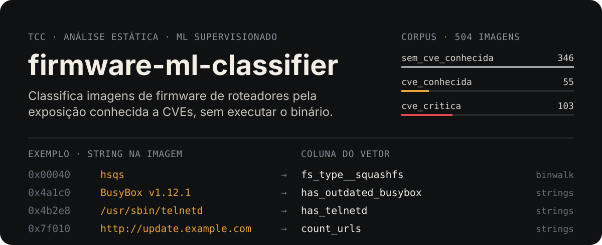
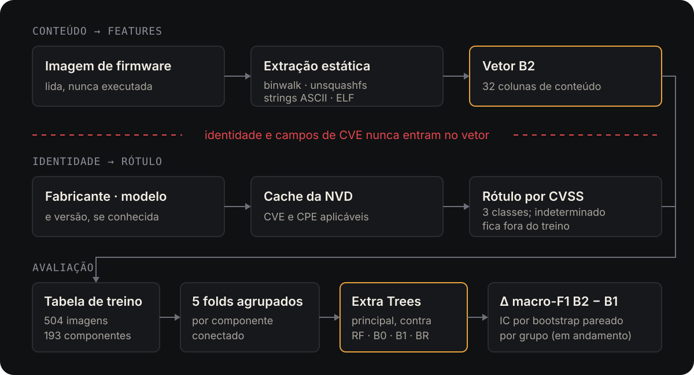

<p align="center">
  
</p>

Trabalho de Conclusão de Curso (Engenharia de Software). O classificador recebe
uma imagem de firmware de roteador, extrai features por **análise estática** e
prevê uma de três classes de **exposição conhecida declarada**:

| Classe | Critério do rótulo |
|---|---|
| `sem_cve_conhecida` | nenhuma CVE aplicável ao produto |
| `cve_conhecida` | CVSS máximo < 9,0 |
| `cve_critica` | CVSS máximo ≥ 9,0 |

O rótulo é um proxy de CVE/CPE publicada para fabricante, modelo e versão, não
vulnerabilidade confirmada. **Ausência de CVE conhecida não prova segurança.**
Quando a aplicabilidade de uma CVE não se decide pela versão, o firmware fica
`indeterminado`: sai do treino e aparece nos relatórios, por fabricante.

## Corpus

Corpus congelado antes de qualquer treino:

| Medida | Valor |
|---|---|
| Imagens no treino | 504 (346 / 55 / 103 por classe) |
| Componentes conectados `firmware_id`–modelo | 193 |
| Fabricantes | ASUS, Belkin, D-Link, Netgear, TP-Link |
| Features no vetor B2 | 32 colunas de conteúdo |
| Excluídas (motivos sobrepostos) | 34 falha de extração, 28 de terceiros, 156 `indeterminado` |

As imagens de firmware não fazem parte do repositório.

## Como funciona

<p align="center">
  
</p>

- **Somente estática.** Desempacota a imagem (`binwalk`, `unsquashfs`) e lê
  bytes, strings ASCII e cabeçalhos ELF. Nenhum binário é emulado ou executado.
  Leituras têm limite `max_bytes` e falhas ficam registradas por arquivo.
- **Rótulo externo.** O rótulo vem só do cache local de CVEs da NVD, consultado
  por fabricante/modelo e filtrado pela versão. Consulta ausente no cache é erro,
  não `sem_cve_conhecida`.
- **Sem vazamento.** Fabricante, modelo, versão e campos derivados de CVE nunca
  entram no vetor. Os folds agrupam todas as versões de um modelo e todas as
  ocorrências do mesmo `firmware_id`.
- **Comparadores.** O conteúdo do binário também carrega identidade (cabeçalhos,
  SDK). Por isso o modelo é comparado a B1, que só vê o fabricante.

### Modelos e baselines

| Braço | Papel | Entrada |
|---|---|---|
| Extra Trees | modelo reportado (B2) | 32 colunas de conteúdo |
| Random Forest | baseline de ML | mesmas 32 colunas |
| B0 `majoritario` | baseline | nenhuma; prevê a classe majoritária do treino |
| B1 `identidade` | diagnóstico | one-hot do fabricante |
| BR `score_firmware` | baseline de regras fixas | sinais extraídos; ver [`docs/SCORING.md`](docs/SCORING.md) |

**Estado.** Os cinco braços já foram treinados nos folds congelados. A avaliação
final, com Δ macro-F1 (B2 − B1), intervalo de confiança por bootstrap pareado
por componente, ablações e importância de features, está em andamento. Este
README não publica métricas antes dela.

## Início rápido

Requer Python ≥ 3.9, [`uv`](https://docs.astral.sh/uv/) e `binwalk` no `PATH`.

```bash
uv sync --extra dev
uv run pytest
```

Pipeline completo, com as imagens em `dataset/raw/<fabricante>/<modelo>/`:

```bash
# 1. Features estáticas (metadados de consulta a partir do caminho)
uv run python scripts/extract_features.py --input dataset/raw/ \
  --output dataset/processed/features_v2.parquet --label-from-path

# 2. Cache de CVEs da NVD (única etapa com rede; NVD_API_KEY opcional)
uv run python scripts/fetch_cves.py --features dataset/processed/features_v2.parquet

# 3. Rótulos a partir do cache
uv run python scripts/generate_labels.py \
  --features dataset/processed/features_v2.parquet \
  --cves dataset/processed/cve_cache_v2.json

# 4. Tabela de treino, validação, folds agrupados e congelamento
uv run python scripts/build_dataset.py
uv run python scripts/validate_dataset.py
uv run python scripts/make_folds.py
uv run python scripts/freeze_corpus.py

# 5. Treino dos cinco braços, métricas OOF por run_id e avaliação final
uv run python scripts/train.py --model all --experiment principal --scheme grouped
uv run python scripts/compute_metrics.py --run-id <run_id> [--run-id ...]
uv run python scripts/evaluate.py
```

Do cache de CVEs em diante, os artefatos registram proveniência (hashes,
configuração, commit) em `.meta.json` ou, no congelamento, em
`corpus.freeze.json`. Os parâmetros vêm de
`configs/*.yaml`; as etapas com `--override chave=valor` aceitam ajuste
registrado na linha de comando. A semente da partição é fixa em
`configs/dataset.yaml`.

<details>
<summary><strong>Detalhes das etapas</strong></summary>

**Extração.** `--findings-output dataset/processed/findings.jsonl` grava os
achados estruturados (`SecurityFinding`) em JSONL, ligados às features por
`firmware_id`; sem a flag só as contagens `count_*`/`has_*` vão para a tabela.
`--label-from-path` é obrigatório para a rotulagem: sem `meta_brand`/`meta_model`,
`generate_labels.py` falha com contexto em vez de inventar rótulo negativo.
`--workers 1` força execução sequencial.

**Cache de CVEs.** Sem `NVD_API_KEY` o intervalo entre requisições é de 6 s
(1 s com a chave). Pares já em cache são pulados (`--force` refaz); `--dry-run`
lista os pares sem rede. Grava `cve_cache_v2.json` e `cve_cache_v2.meta.json`.

**Rótulos.** Grava `labels_v2.csv`, `labels_v2_aliases.jsonl` (CVEs aplicáveis e
indeterminadas por alias) e `labels_v2.meta.json`. `--critical-cvss` muda o
limiar (padrão 9.0); `--dry-run` mostra a distribuição sem salvar.

**Tabela de treino.** `build_dataset.py` lê `configs/dataset.yaml`, junta
features e `security_level` por `firmware_id`, exclui falhas de extração,
firmware de terceiros e `indeterminado`, e troca `fs_type`/`compression_type`
por one-hot de lista fixa. Interrompe sem gravar diante de IDs sem par ou hash
divergente. `validate_dataset.py` confere IDs, colunas proibidas, classes e
hashes.

**Partição e congelamento.** `make_folds.py` gera 5 folds agrupados por
componente conectado; `freeze_corpus.py` grava `corpus.freeze.json`, e o treino
recusa folds ou tabela que divirjam dele. `describe_prevalence.py` descreve a
prevalência dos detectores no corpus congelado.

**Treino.** `train.py` grava cada braço em `models/runs/<run_id>/` e recusa
sobrescrita sem `--force`. `--columns-file` treina um subconjunto de colunas
(ablações). `compute_metrics.py` grava `metrics.csv`, `metrics_per_class.csv` e
`confusion.csv` em `reports/<timestamp>/`.

**Avaliação final.** `evaluate.py` lê `configs/evaluation.yaml`, reaproveita
cada braço da 010 pelo `run_id` (ou o treina, se ausente), incluindo as
ablações B2−D, B2−H e B2′ em Extra Trees, e recusa execução incompleta ou cujo
`run.meta.json` não reproduz o `run_id`. Calcula Δ = macro-F1(B2) −
macro-F1(B1) e as comparações com B0, com IC 95% por bootstrap pareado por
componente conectado (2000 reamostragens, sorteadas uma vez e reusadas em
todas as comparações), a importância por permutação do Extra Trees por fold, as
análises secundárias pré-registradas e as exclusões por fabricante. Grava CSV,
PNG e `report.md` em `reports/<timestamp>/`, idênticos byte a byte entre
gerações; só `created_at` muda em `report.meta.json`.

**Doc2Vec.** O código de Doc2Vec (`scripts/train_doc2vec.py`,
`scripts/inspect_tokens.py`) existe, mas é trabalho futuro: fica fora do vetor
reportado e desligado por padrão na extração (`doc2vec.enabled=false`).

</details>

<details>
<summary><strong>Estrutura do repositório</strong></summary>

| Caminho | Conteúdo |
|---|---|
| `pipeline/` | orquestração da extração por imagem |
| `src/features/` | estatística de bytes, strings ASCII, binwalk, filesystem, ELF desempacotado |
| `src/evidence/` | detectores de strings e achados estruturados (`SecurityFinding`) |
| `src/labeling/` | rótulo a partir do cache de CVEs e casamento de versão |
| `src/dataset/` | tabela de treino, validação, partição, congelamento, prevalência |
| `src/models/` | treino de Extra Trees, Random Forest e baselines |
| `src/evaluation/` | leitura de execuções e métricas OOF |
| `src/scoring.py` | baseline de regras BR |
| `scripts/` | uma CLI por etapa do pipeline |
| `configs/` | parâmetros versionados de cada etapa |
| `tests/` | pytest, incluindo a guarda de vazamento do vetor |

</details>

## Qualidade de código

```bash
uv run pre-commit install
uv run ruff check .
uv run black --check .
uv run mypy src/
```

Dependências ficam em `pyproject.toml` e `uv.lock` (`uv add`, `uv add --optional dev`,
`uv lock --upgrade`).

## Documentação

- [`docs/PIPELINE.md`](docs/PIPELINE.md): etapas, artefatos e decisões do pipeline.
- [`docs/SCORING.md`](docs/SCORING.md): baseline de regras BR.

## Licença

[GPL-3.0](LICENSE).
